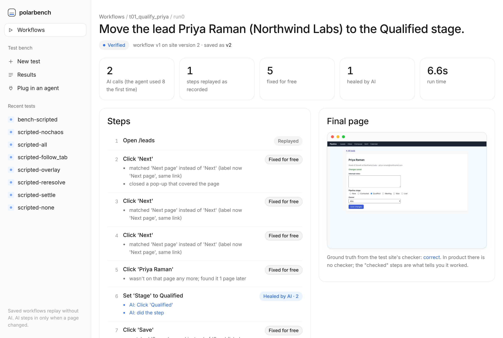
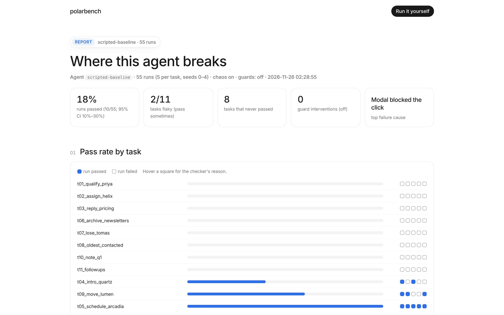

# polarbench: workflow autopilot for browser agents

**Run a saved browser workflow without paying for AI every time. Record the first run that works, replay it for free, and bring the model back only for the step a site redesign broke.**

An independent project built for Polar-style browser agents. It is not made by or affiliated with Polar.

## The problem

Polar lets you "save any task as a workflow. Run it on a schedule, or when something happens." Today every one of those runs is a full agent run. A daily workflow repeats the same clicks on the same pages, but it pays for them as new agent work every time: "Credits are used when Polar runs agent work. Longer tasks use more," and when credits run out, "any scheduled workflows skip their runs" ([pricing](https://polarbrowser.com/pricing)). Polar's own [Frontier Problems](https://polarbrowser.com/blog/frontier-problems) post asks the same questions: "Most tasks that our users use Polar for do not require AGI level intelligence. How can we optimize more for speed?", and how to build agents that "self-manage and self-verify".

Nothing on Polar's public pages describes replaying recorded steps, caching or self-repair of saved workflows (checked Nov 26, 2026). Workflows are saved prompts that rerun the agent.

## What autopilot does

1. **Record.** The first passing run of a task becomes workflow v1. Errored steps, waits and tab switches are dropped. Each element is saved as a fingerprint (label, link, field name, role, group, options), and each save or send keeps what the page showed right after it.
2. **Replay with no AI.** Later runs repeat the steps directly. Pop-ups, slow pages, new tabs and re-sorting lists are handled in the browser. A renamed button ("Save" to "Save changes") or a record that moved to a later page is fixed for free. If two elements look equally right, it refuses to guess.
3. **Heal only what broke.** When a step no longer fits the page, a model gets only that step, with the goal, the steps already done and the steps still to come. It either does the step another way (the stage dropdown is now a row of buttons) or opens what hides it (a form behind a "New event" button). Then replay takes over again. The budget is 8 AI calls. After that, a full agent finishes the task, and the run is flagged for review instead of saved.
4. **Verify.** After every save or send, the page must show what the recording saw: the values that stuck, a status line like "Saved", rows that disappeared. If a check fails, it stops and says why.
5. **Save a new version.** A run that healed or re-matched anything and passed every check saves v2, so the next run is free again. Every version is kept, and rollback is one click.

Steps that send, reply, archive or delete are marked, so a product can ask before them the way Polar does today. Typed text becomes a named input, so a "follow up" note can be any note.

```bash
./polarbench ui                       # Workflows page: record, run, versions, rollback
./polarbench autopilot bench          # the four-row comparison below, no API key needed
./polarbench autopilot bench --agent gemini --healer gemini --runs 3 --out runs/bench-gemini   # free Gemini key
```



## Results

**Real model numbers (Gemini, free tier): in progress.** They will replace the dry run below.

**Dry run with stand-ins (no model at all).** The agent is the scripted macro and the healer is the scripted stand-in, which knows two generic repairs. This proves the mechanics end to end; it is not evidence about models. 11 tasks × 3 seeds, chaos on. Full page: [`docs/autopilot/index.html`](docs/autopilot/index.html).

| How it ran | Site | Correct | Steps needing a model, per run | Runs with no model | Verified |
| --- | --- | --- | --- | --- | --- |
| Agent every time | as recorded | 33/33 | 8.5 | 0/33 | – |
| **Autopilot** | as recorded | **33/33** | **0** | **33/33** | 33/33 |
| Agent every time | after redesign | 6/33 | 4.1 | 0/33 | – |
| **Autopilot** | after redesign | **33/33** | **0.2** | **30/33** | 33/33 |

After the redesign, 3 workflows needed a model once (2 calls for the stage buttons, 1 to open the hidden form), saved version 2, and replayed for free after that. 8 more re-matched renamed elements or moved records for free and saved version 2 too. "Verified but wrong" (autopilot's own check passed, the site's checker failed): 0 of 66. Replay ran about 3× faster than the agent per run.

## The test bench underneath

Autopilot is measured on polarbench's test site. "Pipeline" is a small CRM that misbehaves on purpose: pop-ups, slow loads, new tabs and re-sorting lists, all seeded and logged. `/reset?version=2` turns on a redesign: renamed buttons and fields, six new leads so records move pages, a stage picker that is buttons instead of a dropdown, and the new-event form hidden behind a button. The bench below it runs any agent many times per task and finds the step where runs split, and why.

## Test bench results

Full reports with every failure, its screenshot and its trace: [`docs/index.html`](docs/index.html) (published at https://e16163.github.io/polarbench/ once GitHub Pages is on for `main` / `docs`).

Scripted baseline agent (a recorded macro with simulated model latency), 11 tasks × 5 seeds, same chaos schedule in every row:

| Configuration | Passed | 95% CI | Main failure cause |
| --- | --- | --- | --- |
| No guards | 10/55 (18%) | 10–30% | blocking modal (32 of 45 failures) |
| `settle` only | 16/55 (29%) | 19–42% | blocking modal |
| `reresolve` only | 10/55 (18%) | 10–30% | blocking modal |
| `follow_tab` only | 10/55 (18%) | 10–30% | blocking modal |
| `overlay` only | 26/55 (47%) | 35–60% | wrong tab, slow render |
| **All four guards** | **55/55 (100%)** | 93–100% | none |
| Chaos off (control) | 55/55 (100%) | 93–100% | none |

What this shows:

1. **The tasks are fair.** With chaos off the same agent passes every run, so every failure above comes from the environment, not from impossible tasks or broken checkers.
2. **Failures mask each other.** Fixing only the top cause (modals) lifts the pass rate from 18% to 47%, not to 100%. Once modals stop blocking, the agent gets far enough to hit the next problem (a new tab, a slow inbox). Single-fix evaluations underestimate how much work reliability takes, and also how much a full set of fixes pays off.
3. **All of it is fixable in the browser layer.** With all four guards the agent matches its chaos-off score: 55/55. None of the guards needs a smarter model.



The scripted agent sets a floor and proves the harness works. The interesting numbers come from LLM agents, which you can run for free (below). Real model runs: see `docs/` once they're in.

## Quick start

```bash
git clone https://github.com/e16163/polarbench && cd polarbench
pip install -r requirements.txt
python -m playwright install chromium

./polarbench ui                 # dashboard at http://localhost:8800
```

In the dashboard, pick an agent, tasks, runs per task and guards, then press **Start run**. You get a live grid of runs and the agent's current screen. When the run finishes, open the report, or tick two runs and press **Compare**.

**Reading a report.** The top line is the pass rate. Below it, each task shows one square per run (filled means it passed). "Why runs failed" groups failures by cause: a pop-up blocked a click, the page was still loading, the agent was on the wrong tab, a button moved, or the agent just chose wrong. Further down, every failed run is shown at the exact step where it went wrong, with a screenshot, the error, what the agent said, and the full step list.

The same from a terminal:

```bash
./polarbench run --agent scripted --out runs/scripted                 # free, no key
./polarbench run --agent scripted --guards all --out runs/scripted-all
./polarbench compare runs/scripted runs/scripted-all --out docs/mine  # side-by-side page
./polarbench report runs/scripted                                     # one run's failure report
```

## Models (free options first)

| Agent | Cost | How |
| --- | --- | --- |
| `gemini` | free tier | `export GEMINI_API_KEY=...` (free at aistudio.google.com/apikey). Default model `gemini-3.5-flash-lite`, paced at 14 requests/min. If the daily quota runs out, the run stops cleanly; rerun the same command with `--resume` the next day. |
| `ollama` | free, local | `ollama serve` and `ollama pull qwen3:8b`, then `--agent ollama`. Slow on a laptop, and small models score low. |
| `claude` | paid | `export ANTHROPIC_API_KEY=...`, then `--agent claude --model claude-haiku-5-5 --compact`. Default model `claude-opus-5-5`. |
| `scripted` | free | No model. A floor, and a smoke test for the harness. |

The LLM agents read the same numbered-element view of the page and use the same eight tools (`click`, `type`, `select`, `check`, `goto`, `switch_tab`, `wait`, `done`), so their results are comparable. `--compact` (always on for Gemini and Ollama) sends only the task, a one-line log of past actions and the current page. That keeps every call at about 2 to 3k tokens.

## Plug in your own agent

There are three ways in, depending on how much of the stack your agent owns.

### 1. Your agent drives its own browser (Polar, Browser Use, computer use)

No code changes. The site records what happened from its side and grades the end state.

```bash
./polarbench serve --port 5055
```

```python
import requests
ep = requests.post("http://127.0.0.1:5055/api/episode/start",
                   json={"task": "t01_qualify_priya", "seed": 3, "agent": "my-agent"}).json()
my_agent.run(url=ep["start_url"], instruction=ep["prompt"])     # any browser, any harness
print(requests.post("http://127.0.0.1:5055/api/episode/finish").json())  # {"passed": ..., "reason": ...}
```

A small recorder in every page logs clicks, edits, page loads, tabs and whether a dialog was in the way. On `finish` it writes a trace in the same format the runner uses, so `./polarbench report runs/external-<date>` gives you the divergence analysis too. `GET /api/tasks` lists tasks. See `examples/external_agent.py`.

### 2. Your agent is a policy: page in, action out

Implement two methods (full contract in `agents/base.py`) and pass the class:

```python
class MyAgent:
    name = "my-agent"
    def reset(self, task, seed): ...
    def step(self, obs, obs_text, last_result):
        return {"action": "click", "id": 12}, "why I clicked"
```

```bash
./polarbench run --agent path/to/my_agent.py:MyAgent --guards all
```

`examples/my_agent.py` is a working example.

### 3. Your own tasks

```bash
./polarbench run --tasks-file examples/my_tasks.py --tasks x01_unassign_birch
```

A task is an id, a prompt and a checker `check(con) -> (passed, reason)` over the site's SQLite DB. Helpers such as `untouched_leads` catch side effects.

### CI

`--min-pass-rate 0.9` makes `run` exit with code 1 below the bar, and `./polarbench gate runs/<dir> --min-pass-rate 0.9` checks an existing run. `.github/workflows/ci.yml` runs the tests and a small guarded scripted run on every push, and uploads the report.

## The chaos

All chaos comes from `POST /reset?seed=N`. The same seed gives the same chaos, so a failure can be replayed exactly.

| Chaos | Where | What it breaks |
| --- | --- | --- |
| "What's new" modal appears 0.4 to 1.8 s after load | any page, 30% of loads | clicks are intercepted |
| Live re-sort by recent activity, 0.6 to 1.6 s after load | leads list, 35% | elements the agent saw are re-rendered (stale) |
| Lead links open in a new tab | leads list, 40% | the agent keeps working in the old tab |
| Inbox loads late (0.2 to 2.5 s, `aria-busy`) | inbox | the agent acts on "Loading…" |
| 47 leads, 10 per page | leads list | the target is on page 4 |

Override rates per run with `POST /reset?seed=3&modal=0.6&reorder=0`. `GET /api/chaos` returns the log.

## The tasks

| Id | Task | What makes it hard |
| --- | --- | --- |
| t01 | Move Priya Raman to Qualified | pagination |
| t02 | Assign every Helix Robotics lead to Riley | 3 leads on different pages |
| t03 | Reply to Dana's pricing email, mention Thursday | slow inbox |
| t04 | Email the VP Engineering at Quartz Health | near-duplicate lead (Felix vs Felicity Wagner) |
| t05 | Create "Demo with Arcadia" on Dec 3 at 14:00, linked to the lead | date, time and lead picker |
| t06 | Archive every noreply newsletter, keep everything else | slow inbox, multi-select, don't over-archive |
| t07 | Mark Tomás Ortega Lost with a note | pagination, accented name |
| t08 | Assign the Contacted lead with the oldest activity to Riley | reasoning over a list that re-sorts |
| t09 | Move "Sync with Lumen" from Dec 2 to Dec 4 | edit, don't duplicate |
| t10 | Note "sent deck" on whoever asked about the Q1 rollout | inbox to CRM lookup |
| t11 | Note "follow up" on every person with unread mail | long-horizon: 3 lookups, 3 edits, 15+ steps |

## The guards

Each guard targets one failure class and only uses generic web signals (`aria-busy`, `role=dialog`, `target=_blank`, DOM mutations), nothing specific to this site.

| Guard | Fixes | How |
| --- | --- | --- |
| `settle` | acting before content loads | before observing, wait until nothing is `aria-busy` and the DOM has been quiet for 300 ms (max 6 s) |
| `reresolve` | stale elements | if the element the agent picked is gone, or is swapped out mid-click, find the same element again by tag, label and link, but only if exactly one matches |
| `overlay` | blocking dialogs | if something covers the target, close it, but only through a non-committal button (Dismiss, Close, Not now, ×), never OK, Confirm or Delete |
| `follow_tab` | wrong tab | when a click opens a new tab, switch to it |

Every intervention is logged in the trace and shown to the agent ("[overlay: dismissed overlay 'What's new' before acting]"), so nothing happens silently.

## How the divergence analysis works

Each step is keyed by `(action, target label, url, errored?)`. A failing run's split point is its first step that no passing run of the same task ever took. Matching is by set membership, not position, so taking a different valid route isn't flagged. Passing runs come from the same configuration, plus a chaos-off reference run if you pass `--reference`. The cause is then read at that step:

| Label | Evidence |
| --- | --- |
| modal | the click was intercepted, or a dialog was visible when the agent acted |
| stale element | the element from the agent's last observation no longer exists, or was detached mid-click |
| wrong tab | a new tab opened earlier and the agent is not on it |
| slow render | the page was still loading |
| step limit | the agent looped until it ran out of steps |
| agent logic | none of the above: the model chose wrong |

Environmental labels are checked against the chaos log for that run, and the report shows "confirmed by chaos log" or "not in chaos log". Pass rates come with 95% Wilson intervals, because 5 runs is a small sample and the report should say so.

## Limitations

Autopilot:

- **It pays off on repeat work, not one-off research.** A workflow that reads new content and writes something new every run (drafting, summarizing) still needs the model for that part. Autopilot saves the navigation around it, not the thinking.
- **The redesign is ours.** Version 2 of the test site was written to cover common kinds of change (renames, moved records, a new widget, a hidden form). Real redesigns can be bigger; then healing fails, the full agent finishes, and the workflow is flagged for re-recording.
- **Checks only see the page.** Verification compares what the page shows after a save with what it showed in the recording. A change the page never shows can't be checked. The benchmark also reports "verified but wrong" against the site's own checker, so this gap is measured, not assumed.
- **Logins, 2FA and captchas are out of scope.** Replay runs in the same browser session the agent would.
- **Approvals are marked, not enforced, in this demo.** Steps that send or delete carry a flag and the replay engine has an approval hook; the dashboard and benchmark approve automatically.

Test bench:

- **The site is synthetic.** It is built to reproduce failure modes seen on real sites, and the guards were tested against the same site. They use only generic signals, but they need validating on real apps before anyone trusts the gains.
- **The scripted agent never re-plans,** so it exaggerates how much the environment matters. An LLM agent can notice a dialog and close it on its own. Its failure mix will differ, and measuring that is the point of the LLM runs.
- **5 runs per task is a small sample.** The confidence intervals are wide. Use `--runs 10` or more before drawing per-task conclusions.
- **Cause labels are heuristics** backed by the chaos log. Anything without an environmental trigger falls into "agent logic", which mixes reasoning errors with gaps in the heuristics.
- **Bring-your-own-browser traces** come from DOM events. They see clicks and edits, but not an agent's internal retries or keyboard shortcuts, and they have no screenshots.

## Layout

```
polarbench        CLI: ui, autopilot, run, report, compare, serve, tasks, gate
autopilot/        record, match, replay + heal + verify, versioned store, healers, bench, results page
site/             Flask + SQLite CRM, chaos injection, reset, episode API, page recorder
tasks/            11 tasks + checkers; register() / load_tasks_file() for your own
agents/           browser env + guards, agent interface, scripted, Claude, Gemini/Ollama
runner/           N runs per task: traces, screenshots, resume, CI gate
analysis/         divergence + cause labels + confidence intervals
report/           per-run report and comparison page (static HTML)
ui/               dashboard
examples/         custom agent, custom tasks, external agent
tests/            unit + browser end-to-end tests (pytest)
```
